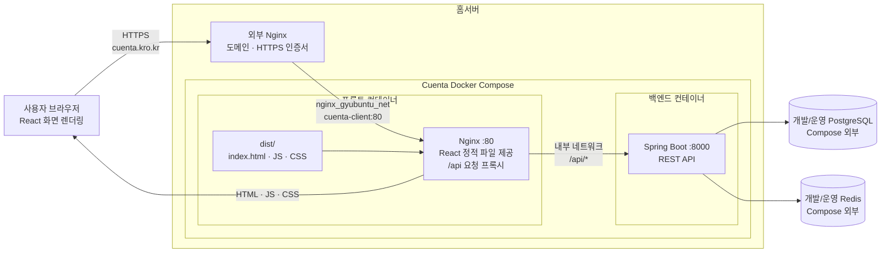
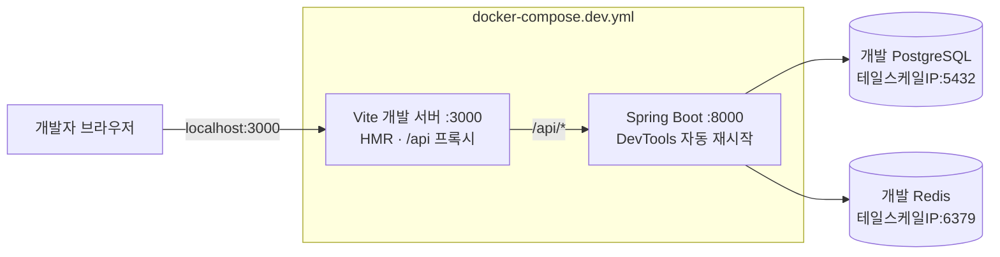

# Cuenta

프론트엔드와 백엔드를 Docker Compose로 함께 실행합니다. PostgreSQL과 Redis는 Compose 외부의 기존 인스턴스를 사용합니다.

## 전체 아키텍처

### 운영 환경



운영 환경에는 역할이 다른 Nginx가 두 개 있습니다.

- **외부 Nginx**: `cuenta.kro.kr` 도메인, TLS 인증서와 HTTPS 연결을 담당합니다.
- **프론트 컨테이너 Nginx**: Vite가 빌드한 `dist` 정적 파일을 제공하고 `/api` 요청을 백엔드로 전달합니다.
- **브라우저**: 전달받은 JavaScript를 실행하여 실제 React 화면을 렌더링합니다.
- **Spring Boot**: API를 처리하고 Compose 외부에 있는 PostgreSQL과 Redis에 연결합니다.

예를 들어 프론트에서 `axios.get("/api/test")`를 실행하면 다음 경로로 요청이 이동합니다.

```text
브라우저 → 외부 Nginx → 프론트 Nginx → Spring Boot → 응답
```

외부 Nginx는 프론트 컨테이너만 바라보고, 백엔드는 Cuenta 내부 Docker 네트워크에 격리됩니다.

### 개발 환경



개발 환경에서는 Nginx 대신 Vite 개발 서버가 프론트 파일과 `/api` 프록시를 담당합니다. 소스가 컨테이너에 마운트되므로 일반적인 코드 수정에는 이미지 재빌드가 필요하지 않습니다.

## 실행

```bash
cp .env.example .env
# .env의 DB/Redis 접속 정보를 실제 환경에 맞게 수정
docker compose up --build -d
```

- 프론트엔드: <http://localhost:3000>
- 백엔드 API: <http://localhost:8000/api>
- 브라우저에서 `/api`로 보내는 요청은 프론트 Nginx가 백엔드로 프록시합니다.

상태와 로그는 다음 명령으로 확인할 수 있습니다.

```bash
docker compose ps
docker compose logs -f
```

종료할 때는 다음을 실행합니다.

```bash
docker compose down
```

## 개발 모드(Hot Reload)

개발용 Compose는 소스 디렉터리를 컨테이너에 마운트합니다. 프론트엔드는 Vite HMR로 즉시 반영되고, 백엔드는 Gradle 연속 컴파일 후 Spring DevTools가 자동으로 재시작합니다. 최초 실행 시 Gradle 및 pnpm 의존성 준비 때문에 시간이 조금 걸릴 수 있습니다.

```bash
docker compose -f docker-compose.dev.yml up --build
```

- 개발 프론트엔드: <http://localhost:3000>
- 개발 백엔드 API: <http://localhost:8000/api>
- 프론트의 `/api` 요청은 개발 백엔드로 프록시됩니다.

백그라운드 실행과 종료:

```bash
docker compose -f docker-compose.dev.yml up --build -d
docker compose -f docker-compose.dev.yml logs -f
docker compose -f docker-compose.dev.yml down
```

## GitHub Actions 배포

`main` 브랜치에 push하거나 Actions에서 수동 실행하면 프론트엔드와 백엔드 이미지를 Docker Hub에 올리고 홈서버에서 해당 커밋 이미지로 교체합니다. 배포 중 기존 Nginx 컨테이너는 중단하지 않으며, 새 컨테이너가 healthy 상태가 된 뒤 Nginx 설정을 검사하고 reload합니다.

필요한 GitHub Actions Secrets:

- `DOCKER_USERNAME`, `DOCKER_PASSWORD`
- `REMOTE_HOST`, `REMOTE_USER`, `REMOTE_PORT`
- `SSH_PRIVATE_KEY`, `REMOTE_HOST_FINGERPRINT`
- `REMOTE_PROJECT_PATH`, `DOCKER_REPO_PREFIX`
- `TS_OAUTH_CLIENT_ID`, `TS_OAUTH_CLIENT_SECRET`
- `ENV_FILE`: `CLIENT_PORT`, `SERVER_PORT`, DB 및 Redis 접속정보를 담은 운영용 환경파일 내용
